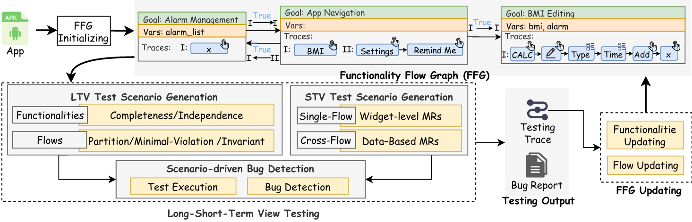

# FuncDroid

FuncDroid is a functionality-oriented mobile GUI testing and exploration tool. Instead of optimizing for traditional coverage metrics alone, it aims to **model app functionalities and their interactions**, then use that model to guide exploration and generate higher-value test cases.

## Motivation

Modern mobile apps evolve quickly and contain many interacting features. In practice, testers still rely heavily on manual, **functionality-oriented** test design because it often finds bugs that coverage-driven exploration misses. Recent research uses large language models (LLMs) to add semantic understanding to GUI testing, but many existing approaches treat a "functionality" as a simple linear event sequence and often test features in isolation - making it hard to uncover deeper bugs caused by **interactions between functionalities**.

FuncDroid addresses this with an inter-functionality, state-aware model and a closed-loop testing workflow.

## Approach (IFO: Inter-Functionality Flow Oriented Testing)

### Overview



### Functionality Flow Graph (FFG)

FuncDroid models an app as a directed **Functionality Flow Graph (FFG)**:
- Each node is a **meaningful functionality**: a complete, user-centric task that is logically indivisible (i.e., it does not contain other meaningful sub-functionalities).
- Each node can be characterized by `(goal, vars, traces)`:
  - `goal`: semantic intent (e.g., "Add alarm")
  - `vars`: state variables used/modified during execution (GUI/data/system-environment dimensions)
  - `traces`: observed execution traces (sequences of widget actions)
- Each edge captures an inter-functionality **flow** annotated with `(pi, phi, pi')`:
  - after executing trace `pi` of functionality `n`, if state condition `phi` holds, then trace `pi'` of functionality `n'` becomes executable
  - `phi` defines a meaningful subset of the app state space, so testing can focus on exploring those state subsets rather than blind exhaustive search

### Iterative, Evidence-Driven Testing Loop

FuncDroid follows an iterative workflow that (1) builds/updates the FFG from execution evidence and (2) generates targeted scenarios to refine the model and find deep interaction bugs:

1) **FFG initializing and updating**
   - Start with lightweight automated exploration to collect initial traces
   - Use an (M)LLM to infer page goals, segment traces into candidate meaningful functionalities, and extract state variables
   - Create initial flows from observed temporal succession (initially setting `phi = True` conservatively), then refine `phi` using new execution evidence
   - Update nodes by merging/splitting/creating functionalities based on semantic coherence and variable usage

2) **Long-short term view scenario testing**
   - Long-term view: generate scenarios to challenge and refine functionality definitions (completeness/independence) and flow preconditions (`phi`) via strategies like repetition, negation, and partition
   - Short-term view: generate metamorphic, data-driven scenarios by transforming GUI/data states at widget-level, intra-functionality, and inter-functionality layers
   - Scenario-driven bug detection: translate scenarios into executable traces, run them adaptively (with recovery), and log evidence for the next update cycle

## What This Repository Contains

- `funcdroid/`: core implementation:
  - `main.py`: CLI entrypoint for the defect-detection workflow
  - `workflow/`: LangGraph-based exploration loop (scenario planning/execution, FFG update, async bug detection, page audit)
  - `model/flow_graph.py`: Functionality Flow Graph structures
  - `automator/`, `connector/`, `device.py`: device automation layer (uiautomator2/HarmonyOS, ADB/HDC)
- `Effectiveness evaluation/`, `Usefulness evaluation/`: experiment outputs and datasets (large; not required for running the tool).

> Full repository (including large evaluation artifacts and datasets): https://github.com/EdgarRhys/FuncDroid_Full

## Prerequisites

- Windows/macOS/Linux with **Python 3.11-3.13**
- Android device with **USB debugging enabled** (or an emulator)
- `adb` available in PATH (Android platform tools)
- `uiautomator2` environment set up for your device
- One **OpenAI-compatible multimodal model endpoint** shared by all model roles (planning, scenario execution, FFG update, and defect detection)

## Installation

```bash
python -m venv .venv
source .venv/bin/activate   # Windows: .venv\Scripts\activate
pip install -r requirements.txt
```

## API Key / LLM Configuration

All model roles share a single OpenAI-compatible endpoint, configured via environment variables (loaded automatically by `python-dotenv`):

```bash
cd funcdroid
cp .env.example .env
```

Then fill in three values in `.env`:

```ini
API_KEY="your_api_key"
BASE_URL="https://your-openai-compatible-endpoint/v1"
MODEL="your_multimodal_model"
```

Optional runtime knobs (timeouts, budgets, log rotation, etc.) are documented inline in `.env.example`.

## Quick Start

1) Connect your Android device and verify it is visible:

```bash
adb devices
python -m uiautomator2 -s <device-id> init
```

2) Run FuncDroid from `funcdroid/`:

```bash
cd funcdroid

# Test the app currently in the foreground
python main.py --device-id emulator-5554

# Or test a specific installed app
python main.py --device-id emulator-5554 --package-name com.example.app

# Use iteration control instead of wall-clock time
python main.py --device-id emulator-5554 --max-iterations 20 --total-time 0
```

Artifacts (FFG, traces, screenshots, bug reports, LLM usage stats) are written to `output/`.

## Bug Showcase

FuncDroid has discovered a collection of real-world functional bugs in popular mobile applications. We provide a public bug showcase containing reviewed and reproducible evidence, including execution traces, screenshots, bug descriptions, and confirmation status.

[FuncDroid Bug Showcase](https://fim-bugs.sites.veilaxis.com/)

The showcase presents bugs discovered during automated exploration and preserves the corresponding evidence for reproduction and further analysis.

## Citation

If you use FuncDroid in your research or project, please consider citing:

1. Jinlong He, Changwei Xia, Binru Huang, Jiwei Yan, Jun Yan, Jian Zhang. FuncDroid: Towards Inter-Functional Flows for Comprehensive Mobile App GUI Testing. ISSTA 2026. [paper](https://arxiv.org/abs/2602.12834)

```bibtex
@inproceedings{FuncDroid,
      title={FuncDroid: Towards Inter-Functional Flows for Comprehensive Mobile App GUI Testing},
      author={Jinlong He and Changwei Xia and Binru Huang and Jiwei Yan and Jun Yan and Jian Zhang},
      booktitle={Proceedings of the 35th ACM SIGSOFT International Symposium on Software Testing and Analysis (ISSTA)},
      year={2026}
}
```

## Maintainers and Contributors

FuncDroid is actively developed and maintained by members of [SQUARE Research Group](https://square16.org/):

- [Jinlong He](https://hanada31.github.io/)([@Jinlong-He](https://github.com/Jinlong-He))
- [Changwei Xia](https://hanada31.github.io/)([@daxiami233](https://github.com/daxiami233))
- [Binru Huang](https://hanada31.github.io/)([@ningxiudg](https://github.com/ningxiudg))
- [Jiwei Yan](https://hanada31.github.io/)([@hanada31](https://github.com/hanada31))

## Contributing

FuncDroid is an open-source research project, and contributions from the community are welcome.
